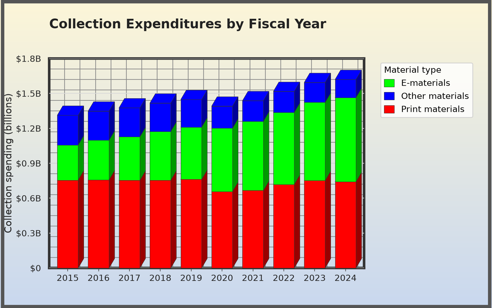

In this exercise you will critique a data visualization and design an improved alternative by using the [companion guide](handout.qmd). Instead of building the data visualizaton from sratch, you will stack ready-made layers in Miro to build the chart.

## Exercise steps

1. **Pick a story.** Review the data visualization and data below and think about the story you might want to tell. 
2. **Build it.** In the [Miro board](https://bit.ly/dlf-vis-it-exercise){target="_blank" rel="noopener"}, stack one layer for each design decision on your canvas. 
3. **Explain it.** Add a sticky note next to your chart explaining your thinking.

## The data

U.S. public library spending on collections, by material type, for fiscal years 2015–2024. These are national totals for all public library systems in the 50 states and DC.

- **Print materials:** books, serials and other print items.
- **E-materials:** e-books, e-audio, e-video, databases and other electronic content.
- **Other materials:** physical formats that aren't print, such as DVDs, audio CDs and microform.

{fig-alt="A 3D stacked bar chart titled 'Collection Expenditures by Fiscal Year' showing U.S. public library collection spending in billions of dollars from 2015 to 2024. Each bar stacks print materials in red at the bottom, e-materials in bright green in the middle and other materials in blue on top. The chart has a heavy dark border, a yellow-to-blue gradient background, dense gridlines and a legend that lists the materials in a different order from the stacks. The same data are in the table below."}

::: {.data-table}
| Fiscal year | Print (\$M) | Print (%) | E-materials (\$M) | E-materials (%) | Other (\$M) | Other (%) | Total (\$M) |
|---:|---:|---:|---:|---:|---:|---:|---:|
| 2015 | 756 | 57.6 | 301 | 23.0 | 255 | 19.4 | 1,312 |
| 2016 | 756 | 56.1 | 342 | 25.3 | 250 | 18.6 | 1,348 |
| 2017 | 754 | 54.8 | 374 | 27.2 | 248 | 18.0 | 1,376 |
| 2018 | 755 | 53.3 | 419 | 29.6 | 243 | 17.1 | 1,417 |
| 2019 | 761 | 52.6 | 449 | 31.0 | 236 | 16.3 | 1,447 |
| 2020 | 658 | 47.3 | 544 | 39.1 | 189 | 13.6 | 1,390 |
| 2021 | 666 | 46.3 | 595 | 41.4 | 177 | 12.3 | 1,437 |
| 2022 | 718 | 47.3 | 619 | 40.8 | 180 | 11.8 | 1,517 |
| 2023 | 751 | 47.1 | 672 | 42.2 | 170 | 10.7 | 1,594 |
| 2024 | 741 | 45.8 | 724 | 44.7 | 155 | 9.6 | 1,620 |

: Public library collection expenditures by material type, FY2015–FY2024, in millions of current dollars and as a percent of each year's total. {.striped .hover}
:::

**Source:** Institute of Museum and Library Services, [Public Libraries Survey](https://www.imls.gov/research-evaluation/surveys/public-libraries-survey-pls){target="_blank" rel="noopener"}, FY2015–FY2024 (public domain). Amounts are in current dollars, not adjusted for inflation.

[Download the data (CSV)](data/collection_expenditures.csv){download="collection_expenditures.csv"}

